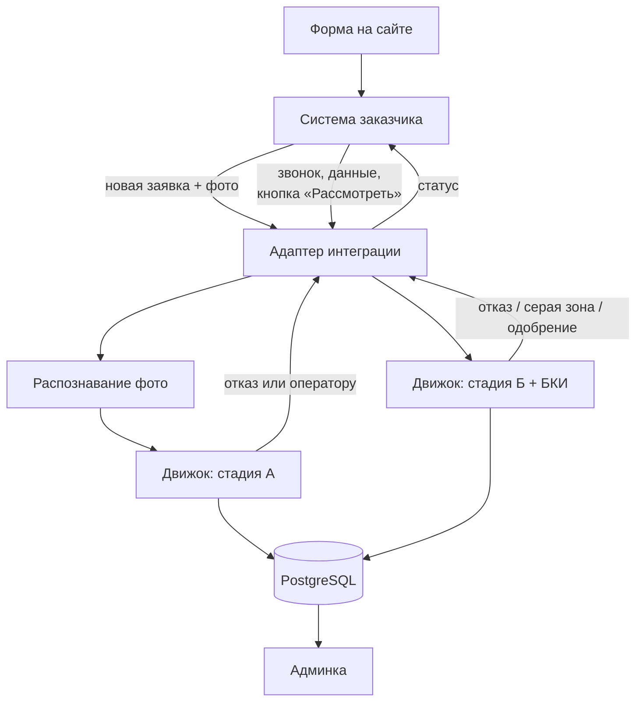
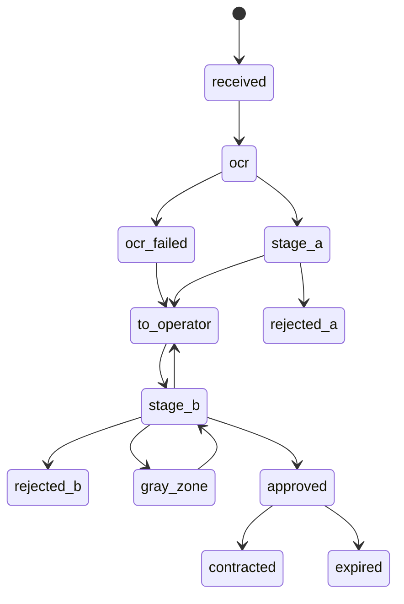

# ТЗ: система скоринга исламской рассрочки DIALOG — Этап 1

2026-09-19 · @Someone

## Цель и границы

Система автоматизирует принятие решений по заявкам на исламскую рассрочку: принимает заявку с сайта, проверяет заявителя по доступным источникам, применяет настраиваемые правила и выдаёт одно из трёх решений — одобрить, отказать, отправить на ручную проверку. Сейчас решения принимает один сотрудник вручную.

Вторая, не менее важная цель: накопить корректно размеченные данные, чтобы через 9–12 месяцев обучить собственную скоринговую модель. Требования к логированию в этом ТЗ подчинены именно ей.

### Что входит в этап 1

- Модуль распознавания паспорта по фото (провайдер OCR выбирается отдельно, модуль заменяемый)
- Изолированный сервис принятия решений с собственной БД и копией анкет
- Интеграция с системой заказчика через служебный аккаунт оператора
- Стадия А: автоматические проверки по паспорту сразу после подачи — МВД, Росфинмониторинг, ФССП, Федресурс, ФНС, чёрный список
- Стадия Б: проверка после звонка оператора — финансовые правила, БКИ, итоговое решение
- Движок правил с конфигом, меняемым без деплоя
- Админка для риск-менеджера: просмотр заявок, пороги, аналитика
- Импорт выданных договоров и платежей для расчёта исходов
- Полное логирование всех данных и решений

### Что входит в этап 1.5

Интеграция с БКИ: кредитный отчёт, покупной скоринговый балл, расчёт ПДН по фактическим обязательствам. Выделено отдельно, потому что срок зависит от бюро, а не от разработки.

### Что явно не делаем сейчас

- Собственную ML-модель — данных для обучения нет, это этап 2
- Расширение формы на сайте — форма остаётся как есть, добавляется только согласие на запрос КИ
- Рабочее место оператора — оператор работает в системе заказчика
- Автоматическую биометрическую идентификацию
- Личный кабинет клиента
- Электронную подпись договоров

## Бизнес-контекст

Заказчик — «Финансовый партнёр DIALOG», участник эксперимента по партнёрскому финансированию (ФЗ-417), Махачкала. Портфель около 55 млн ₽. Сегмент — только физические лица, продукт — только мурабаха: организация выкупает выбранный клиентом товар и продаёт его в рассрочку с фиксированной наценкой.

Заявленный срок принятия решения — 15 минут. Выдача товара и подписание договора всегда происходят очно в офисе.

### Тарифы

| Тариф | Первый взнос | Наценка | Кому |
| --- | --- | --- | --- |
| Выгодный | от 20% | сниженная | всем, кто вносит взнос |
| Базовый | не требуется | стандартная | всем |
| Постоянному клиенту | уточняется | сниженная | повторные обращения |

Тариф — не просто поле анкеты, а параметр решения. Система может отказать по «Базовому» и одобрить по «Выгодному»: первый взнос снижает и вероятность дефолта, и потери при дефолте. Предложение альтернативного тарифа вместо отказа — штатный исход, повышающий конверсию.

Дополнительно возможен поручитель. Поручитель — второй проверяемый субъект с полным набором проверок, привязанный к той же заявке.

### Ограничения, вытекающие из шариата

1. Наценка фиксирована на момент сделки и не может расти. Штрафных процентов за просрочку нет — допустима только неустойка, направляемая на благотворительность и не являющаяся доходом организации.
2. Следствие для риска: апсайд по сделке жёстко ограничен наценкой, потери при дефолте нечем компенсировать. Допустимая доля дефолтов ниже, чем в обычном потребкредите с сопоставимой ставкой.
3. Организация владеет товаром до полного расчёта. Это снижает потери при дефолте, но только по ликвидным категориям — LGD дифференцируется по категории товара.
4. Категория товара проверяется на допустимость по шариату (алкоголь, табак, свинина, азартные игры и прочее). Реализуется справочником, не классификатором.

### Регуляторный статус

Организация является источником формирования кредитной истории по 218-ФЗ: обязана передавать сведения в БКИ и вправе запрашивать кредитные отчёты с согласия субъекта. Отсюда — обязательное отдельное согласие на запрос КИ в форме заявки, собираемое с первого дня, даже до подключения бюро.

Применяются также 152-ФЗ (персональные данные, хранение в РФ) и 115-ФЗ (проверка по перечням Росфинмониторинга).

## Архитектура

Система — отдельный сервис со своей БД. Первичный источник заявок — система заказчика: клиент подаёт заявку на сайте, оператор работает с ней в их интерфейсе. Наш сервис получает заявку, проверяет, принимает решение и записывает результат обратно в их систему через API под служебным аккаунтом оператора. Анкета хранится в обеих системах.



### Компоненты

**Адаптер интеграции.** Единственная точка связи с системой заказчика. Забирает новые заявки и заявки, отправленные оператором на рассмотрение, пишет статусы и комментарии обратно. Работает под служебным аккаунтом. Подробно — в разделе про интеграцию.

**Модуль распознавания фото.** Получает три фото, возвращает структурированные поля паспорта и страницы регистрации с оценкой уверенности по каждому полю. На старте — Claude через API Anthropic: извлечение полей в JSON по фиксированной схеме, плюс вспомогательные флаги — нечитаемое фото, обрезанный разворот, признаки редактирования изображения. Флаги — подсказка оператору, не основание для отказа. Модуль реализует общий интерфейс, смена провайдера — один файл.

**Движок решений.** Читает конфиг правил, применяет их к собранным данным, формирует решение с перечнем сработавших правил. Бизнес-логика — только в конфиге. Работает в двух стадиях с разными наборами правил.

**Быстрые проверки.** Валидация паспорта, локальные реестры МВД и Росфинмониторинга, чёрный список, справочник категорий товаров. Выполняются синхронно.

**Очередь задач.** Обращения к внешним сервисам — ФССП, Федресурс, ФНС, БКИ. Каждое — отдельная задача с таймаутом и повторами.

**Синхронизатор реестров.** Раз в сутки скачивает выгрузки МВД и Росфинмониторинга, проверяет целостность, атомарно переключает таблицы. Алерт при отсутствии обновления.

**Импортёр платежей.** Загружает договоры и платежи из системы заказчика. Источник исходов для будущей модели.

**Админка.** Для риск-менеджера и владельца: просмотр заявок и решений, настройка порогов, аналитика. Оператор в ней не работает — его рабочее место в системе заказчика.

### Две стадии решения

По одному паспорту можно уверенно отказать, но нельзя уверенно одобрить: нет дохода и кредитной истории. Поэтому стадии разделены.

1. **Стадия А — сразу после подачи, без БКИ.** Распознавание фото, затем бесплатные проверки по паспорту. Исходы: `отказ`, если сработал жёсткий стоп-фактор (недействительный паспорт, перечни, чёрный список, крупные долги у приставов), либо `передать оператору`. Одобрения на этой стадии нет. Оператор не тратит время на звонки тем, кому всё равно откажут, а организация не платит за КИ по заведомым отказникам.
2. **Стадия Б — после звонка, всегда с БКИ.** Оператор вносит в своей системе доход, занятость, обязательства, поручителя, контакты и нажимает «Рассмотреть». Наш сервис забирает обновлённую анкету, автоматически запрашивает кредитный отчёт, применяет финансовые правила и скор. Исходы: `отказ`, `серая зона`, `одобрение`. Одобрение без кредитной истории невозможно: если БКИ недоступно или нет согласия — серая зона.

Каждая стадия пишется отдельной записью решения. Предыдущие не перезаписываются.

### Принципы, обязательные к соблюдению

- Никакой внешний источник не является критичным: при его недоступности заявка уходит на ручную проверку, а не падает.
- Ничего не перезаписывается. Любое изменение — новая запись со ссылкой на предыдущую.
- Сырые ответы источников сохраняются как пришли, до разбора.
- Признаки фиксируются снапшотом на момент решения, а не пересчитываются при просмотре.
- Бизнес-логика — в конфиге, а не в коде.

## Интеграция с системой заказчика

Наш сервис работает в системе заказчика как оператор, через их API под выделенным служебным аккаунтом. От подрядчика требуется только выдать аккаунт и документацию к API — дорабатывать их систему не нужно, кроме кнопки «Рассмотреть».

### Служебный аккаунт

- Отдельная учётная запись с явным именем, например «Скоринг-система». Не личный аккаунт сотрудника — иначе в их журнале действия машины неотличимы от действий человека.
- Минимальные права: чтение заявок и фото, смена статуса, добавление комментария. Без права удалять, редактировать анкету, выдавать договоры.
- Логин и пароль или токен хранятся у нас в переменных окружения, зашифрованно, не в коде.
- Каждое действие нашего сервиса в их системе дублируется в наш журнал `integration_events`.

### Что нам нужно от их API

| Операция | Зачем | Что уточнить у подрядчика |
| --- | --- | --- |
| Список новых заявок | запуск стадии А | фильтр по статусу и дате |
| Список заявок «на рассмотрение» | запуск стадии Б | как помечается нажатие кнопки «Рассмотреть» |
| Заявка по ID со всеми полями | копия анкеты | формат, полнота полей |
| Скачивание фото заявки | распознавание | формат, размер, способ доступа |
| Смена статуса заявки | запись решения | перечень допустимых статусов |
| Добавление комментария | обоснование решения для оператора | ограничение длины |
| Вебхук о событиях | мгновенная реакция вместо опроса | есть ли вообще |

Если вебхуков нет, адаптер опрашивает их API раз в 30–60 секунд. Для обещанных 15 минут этого достаточно.

### Соответствие статусов

| Наш исход | Статус в их системе | Комментарий оператору |
| --- | --- | --- |
| Стадия А: отказ | Отказ | причина кодом и текстом |
| Стадия А: передать оператору | На звонок | краткая сводка проверок |
| Стадия Б: не хватает данных | На звонок | список недостающих полей |
| Стадия Б: отказ | Отказ | причина кодом и текстом |
| Стадия Б: серая зона | Требует решения | что вызвало сомнение |
| Стадия Б: одобрение | Одобрено | сумма, срок, тариф, взнос |
| Ошибка проверки или БКИ | Требует решения | какой источник недоступен |

Названия статусов в их системе уточняются по документации. Соответствие задаётся в конфиге, не в коде.

### Дублирование анкет

Анкета живёт в обеих системах. Их система — источник правды для оператора. Наша копия — снимок на момент каждой стадии, неизменяемый.

При каждом получении заявки адаптер сохраняет полный ответ их API в `external_snapshots` как пришёл. Если оператор после стадии Б изменит данные и снова нажмёт «Рассмотреть», это новая стадия с новым снимком — старый остаётся. Так видно, что именно правил оператор между проверками, а это сильный сигнал для будущей модели.

### Идемпотентность и сбои

- Каждая заявка идентифицируется их ID. Повторное получение той же заявки в том же состоянии не запускает проверки заново.
- Если запись статуса в их систему не удалась, решение у нас сохраняется, а запись повторяется из очереди с нарастающей задержкой.
- Если их API недоступен дольше заданного времени — алерт администратору.
- Наш сервис никогда не меняет статус заявки, которую оператор уже перевёл вручную. Перед записью статус сверяется: если он изменился с момента получения, запись отменяется и логируется конфликт.

### Дополнительные таблицы

```sql
ALTER TABLE applications ADD COLUMN external_id text NOT NULL UNIQUE;

CREATE TABLE external_snapshots (
    id              uuid PRIMARY KEY DEFAULT gen_random_uuid(),
    application_id  uuid NOT NULL REFERENCES applications(id),
    stage           text NOT NULL,   -- A | B
    payload_raw     jsonb NOT NULL,  -- ответ их API как пришёл
    received_at     timestamptz NOT NULL DEFAULT now()
);

CREATE TABLE ocr_results (
    id              uuid PRIMARY KEY DEFAULT gen_random_uuid(),
    application_id  uuid NOT NULL REFERENCES applications(id),
    provider        text NOT NULL,
    response_raw    jsonb NOT NULL,
    fields          jsonb NOT NULL,  -- поле: значение + уверенность
    min_confidence  numeric(4,3),
    created_at      timestamptz NOT NULL DEFAULT now()
);

CREATE TABLE integration_events (
    id              bigserial PRIMARY KEY,
    application_id  uuid REFERENCES applications(id),
    direction       text NOT NULL,   -- inbound | outbound
    operation       text NOT NULL,
    request         jsonb,
    response        jsonb,
    status          text NOT NULL,   -- ok | error | conflict | retry
    attempt         int NOT NULL DEFAULT 1,
    created_at      timestamptz NOT NULL DEFAULT now()
);
```

## Жизненный цикл заявки

Состояния ниже — внутренние состояния нашего сервиса. В систему заказчика транслируются только итоговые исходы каждой стадии (см. раздел про интеграцию).



| Состояние | Что означает | Кто переводит дальше |
| --- | --- | --- |
| received | Заявка получена из системы заказчика | Система |
| ocr | Распознавание фото | Система |
| ocr\_failed | Фото нечитаемы или уверенность ниже порога | Оператор |
| stage\_a | Бесплатные проверки по паспорту, без БКИ | Система |
| rejected\_a | Отказ по жёсткому стоп-фактору | Финальное |
| to\_operator | Передано оператору на звонок | Оператор |
| stage\_b | Проверки после звонка, включая БКИ | Система |
| rejected\_b | Отказ по результатам стадии Б | Финальное |
| gray\_zone | Решение за оператором | Оператор |
| approved | Одобрено, ожидается визит | Оператор |
| contracted | Договор подписан | Финальное |
| expired | Одобрение истекло | Финальное |

### Правила переходов

- `ocr_failed` не означает отказ. Оператор получает заявку с пометкой «данные не распознаны», при звонке просит перефотографировать или вносит паспортные данные вручную, и стадия А запускается повторно.
- Из `rejected_a` возврата нет: отказ по жёсткому стоп-фактору окончателен.
- Если в анкете не хватает данных, стадия Б возвращает заявку в `to_operator` со списком недостающего, не запрашивая БКИ.
- Стадия Б может запускаться повторно: оператор поправил данные и снова нажал «Рассмотреть». Каждый запуск — новая запись решения и новый снимок анкеты.
- Решение оператора по `gray_zone` и любое расхождение с нашим решением фиксируются в `manual_overrides` — забираем из их системы через API.
- `approved` действует 14 дней. По истечении — `expired`.
- Любой переход пишется в `status_history`.

### Поручитель

Данные поручителя оператор вносит при звонке. Паспортные проверки поручителя запускаются на стадии Б вместе с проверками заявителя. Отказ по поручителю не означает отказ по заявке: система возвращает решение без поручителя — обычно с другим тарифом, первым взносом или меньшей суммой.

## Конвейер проверок

Порядок определяется стоимостью и скоростью: сначала бесплатное и мгновенное, затем бесплатное и медленное, в последнюю очередь платное. Платный запрос в БКИ делается только на стадии Б — для тех, кто прошёл все бесплатные проверки и с кем уже поговорил оператор.

### Стадия А, шаг 1. OCR

Распознавание трёх фото. На выходе — поля паспорта и прописки с уверенностью по каждому. Если уверенность ключевых полей (серия, номер, ФИО, дата рождения) ниже порога — `ocr_failed`, заявка уходит оператору без проверок.

Порог уверенности задаётся в конфиге. Все распознанные поля в карточке помечены как требующие подтверждения оператором.

### Стадия А, шаг 2. Локально, синхронно

| Проверка | Источник | При срабатывании |
| --- | --- | --- |
| Формат и контрольная логика паспорта | вычисление | отказ |
| Срок действия паспорта (20 и 45 лет) | вычисление | отказ |
| Возраст от 21 года | вычисление | отказ |
| Код подразделения против региона выдачи | справочник | флаг |
| Совпадение данных с фото паспорта и прописки | вычисление | флаг |
| Недействительные паспорта | локальная копия МВД | отказ |
| Перечни Т/Э, ФРОМУ, МВК, ООН | локальная копия Росфинмониторинга | отказ, блокировка |
| Чёрный список организации | своя таблица | отказ |
| Дубль заявки за N дней | своя БД | флаг |

### Стадия А, шаг 3. Внешние бесплатные, асинхронно

| Источник | Способ | Таймаут | Повторы | При недоступности |
| --- | --- | --- | --- | --- |
| ФНС, получение ИНН | HTTP | 10 с | 2 | пропуск, флаг |
| ФССП, исполнительные производства | официальное API, асинхронное | 120 с на опрос | 3 | флаг оператору |
| Федресурс, банкротства | парсинг | 20 с | 2 | флаг оператору |

ФССП работает по схеме «отправил запрос — получил ID — опрашиваешь статус». Дата рождения обязательна — без неё пустой результат.

Итог стадии А: `отказ` либо `передать оператору` с краткой сводкой в комментарии — что проверено, что нашлось, на что обратить внимание при звонке.

### Стадия Б. После звонка

Запускается кнопкой «Рассмотреть» в системе заказчика после звонка. Адаптер забирает обновлённую анкету. Запрос в БКИ — обязательная часть стадии: без кредитной истории одобрить нельзя.

| Шаг | Что делаем | При срабатывании |
| --- | --- | --- |
| Проверка полноты | доход, занятость, обязательства, категория товара, параметры сделки | вернуть оператору со списком недостающего, БКИ не запрашивать |
| Шариатский фильтр | категория товара по справочнику | отказ, БКИ не запрашивать |
| Лимиты сделки | сумма, срок, взнос, тариф | отказ или альтернативный тариф |
| Проверки поручителя | весь набор стадии А по его паспорту | решение без поручителя |
| Согласие на КИ | наличие и срок действия | серая зона: запрос невозможен |
| Кэш КИ | есть ли отчёт по клиенту младше 30 дней | использовать кэш, не платить повторно |
| Запрос в БКИ | полный отчёт + скоринговый балл | при недоступности — серая зона с пометкой |
| Расчёт признаков | признаки из КИ, ПДН по фактическим обязательствам | — |
| Финансовые правила и скор | по конфигу | отказ / серая зона / одобрение |

Дешёвые проверки стадии Б (полнота, шариат, лимиты) выполняются до запроса в БКИ — если они уже дают отказ, платить за отчёт незачем.

Итог пишется в систему заказчика с обоснованием: для одобрения — сумма, срок, тариф, взнос; для отказа — причина; для серой зоны — что именно вызвало сомнение.

Расхождение между заявленными при звонке обязательствами и фактическими из КИ фиксируется отдельным признаком — это сильный сигнал для будущей модели.

Если оператор поправил данные и снова нажал «Рассмотреть», стадия Б запускается заново, а отчёт БКИ берётся из кэша.

### Поведение при отказе источника

Ни один внешний источник не является блокирующим. Каждая проверка завершается одним из статусов: `ok`, `hit`, `no_data`, `source_unavailable`, `error`.

При `source_unavailable` заявка не отклоняется и не одобряется автоматически — она переводится в `manual_review` с явной пометкой, какой источник недоступен. Андеррайтер видит пометку и может проверить вручную на сайте ведомства.

Все статусы сохраняются в базе вместе с сырым ответом и временем выполнения. Доля `source_unavailable` — метрика здоровья системы, выводится на дашборд.

## Источники данных

| Источник | Доступ | Стоимость | Обновление | Ключ поиска |
| --- | --- | --- | --- | --- |
| МВД, недействительные паспорта | файловая выгрузка | бесплатно | ежесуточно | серия + номер |
| Росфинмониторинг, перечни | файлы с fedsfm.ru | бесплатно | ежесуточно | ФИО + дата рождения |
| ФССП, исполнительные производства | официальное API | бесплатно | по запросу | ФИО + дата рождения |
| Федресурс, банкротства | парсинг | бесплатно | по запросу | ФИО + дата рождения |
| ФНС, ИНН физлица | HTTP-сервис | бесплатно | по запросу | ФИО + ДР + паспорт |
| БКИ | договор, API | платно | по запросу | ФИО + ДР + паспорт |

### Файловые реестры

МВД публикует список недействительных паспортов целиком, архивом. Десятки миллионов записей вида серия+номер. Разворачивается в локальную таблицу с индексом, проверка выполняется обычным запросом за миллисекунды. Онлайн-форма МВД защищена капчей и для автоматизации не годится.

Росфинмониторинг публикует перечни на fedsfm.ru в машиночитаемом виде. Объём небольшой — десятки тысяч записей. Перечней четыре: Т/Э (терроризм и экстремизм), ФРОМУ (оружие массового уничтожения), решения Межведомственной комиссии, сводные списки Совбеза ООН.

Файловый подход надёжнее API: мгновенно, без сетевых зависимостей, без лимитов, и позволяет перепроверять весь действующий портфель при каждом обновлении перечня.

### Особенности сверки по перечням

Сверка идёт по ФИО и дате рождения, поэтому нужен нечёткий поиск. В Дагестане это особенно чувствительно: распространённые фамилии дают массовые ложные совпадения, а транслитерация арабских имён вариативна.

Требования: нормализация ФИО перед сравнением, нечёткое сопоставление с настраиваемым порогом, обязательный ручной разбор совпадений, журнал разобранных совпадений, чтобы один и тот же ложный хит не всплывал при каждой заявке.

### ФССП

Официальное API на api-ip.fssp.gov.ru. Регистрация через форму с защитой от автоматической регистрации, дальше ключ доступа передаётся в каждом запросе. API асинхронный: в ответ приходит идентификатор, результат забирается отдельными методами. Поддерживает пакетные запросы.

Риск: API отключали в прошлом. Фолбэк — ручная проверка через сайт, при объёме в десятки заявок это приемлемо.

Важно различать типы производств. Накопленные штрафы ГИБДД на несколько тысяч рублей — шум. Взыскание по кредитному договору на сотни тысяч — почти автоматический отказ. Правило должно учитывать тип и сумму, а не просто факт наличия.

### Федресурс

Публичного API нет. Реестр открытый, оператор — «Интерфакс», но поиск доступен только через веб-интерфейс. Реализация — обращение к внутреннему эндпоинту, который использует сам сайт. Хрупко: ломается при редизайне, требует периодической починки.

Банкротство — сигнал сильный, но редкий, и почти всегда виден в кредитном отчёте. Если реализация затягивается, этот источник можно отложить до подключения БКИ без существенной потери качества.

### ФНС

Сервис «Узнать ИНН» принимает ФИО, дату рождения и паспортные данные, возвращает ИНН. Официально не документирован, формат менялся — в частности, добавлялось обязательное согласие на обработку персональных данных. Закладывать как нестабильный источник.

ИНН сам по себе для скоринга не нужен, но требуется для будущих проверок и упрощает идентификацию клиента при повторных обращениях.

## Схема базы данных

PostgreSQL. Ключи — UUID. Все временные метки в UTC с таймзоной. Денежные суммы — `numeric(14,2)`, никогда не `float`.

### Клиенты и заявки

```sql
CREATE TABLE clients (
    id              uuid PRIMARY KEY DEFAULT gen_random_uuid(),
    last_name       text NOT NULL,
    first_name      text NOT NULL,
    middle_name     text,
    birth_date      date NOT NULL,
    gender          text,
    passport_series char(4) NOT NULL,
    passport_number char(6) NOT NULL,
    inn             char(12),
    phone           text NOT NULL,
    email           text,
    created_at      timestamptz NOT NULL DEFAULT now(),
    UNIQUE (passport_series, passport_number)
);

CREATE TABLE applications (
    id                  uuid PRIMARY KEY DEFAULT gen_random_uuid(),
    client_id           uuid NOT NULL REFERENCES clients(id),
    number              bigserial UNIQUE,
    channel             text NOT NULL,          -- online | office
    status              text NOT NULL,
    -- параметры сделки
    goods_name          text NOT NULL,
    goods_category_id   uuid REFERENCES goods_categories(id),
    merchant_name       text,
    merchant_city       text,
    goods_price         numeric(14,2) NOT NULL,
    down_payment        numeric(14,2) NOT NULL DEFAULT 0,
    term_months         int NOT NULL,
    tariff              text NOT NULL,
    requested_amount    numeric(14,2) NOT NULL,
    -- анкета: снимок на момент подачи, неизменяемый
    profile             jsonb NOT NULL,
    -- технические данные
    ip                  inet,
    user_agent          text,
    device_fingerprint  text,
    form_timings        jsonb,
    utm                 jsonb,
    consent_pd_at       timestamptz NOT NULL,
    consent_bki_at      timestamptz,
    submitted_at        timestamptz NOT NULL DEFAULT now(),
    created_at          timestamptz NOT NULL DEFAULT now()
);

CREATE INDEX ON applications (client_id);
CREATE INDEX ON applications (status, submitted_at DESC);
```

Поле `profile` хранит анкету целиком как она пришла. Структурированные поля дублируются в колонках только там, где по ним идёт поиск или правила. Анкета никогда не редактируется: исправление — новая версия в `application_amendments`.

### Поручители

```sql
CREATE TABLE guarantors (
    id              uuid PRIMARY KEY DEFAULT gen_random_uuid(),
    application_id  uuid NOT NULL REFERENCES applications(id),
    client_id       uuid REFERENCES clients(id),
    profile         jsonb NOT NULL,
    status          text NOT NULL,
    created_at      timestamptz NOT NULL DEFAULT now()
);
```

### Проверки и сырые ответы

```sql
CREATE TABLE checks (
    id              uuid PRIMARY KEY DEFAULT gen_random_uuid(),
    application_id  uuid NOT NULL REFERENCES applications(id),
    subject_type    text NOT NULL,   -- applicant | guarantor
    subject_id      uuid,
    source          text NOT NULL,   -- mvd | rosfinmon | fssp | fedresurs | fns | bki | blacklist
    status          text NOT NULL,   -- ok | hit | no_data | source_unavailable | error
    request         jsonb,
    response_raw    jsonb,           -- ответ как пришёл, до разбора
    parsed          jsonb,           -- разобранный результат
    started_at      timestamptz NOT NULL,
    finished_at     timestamptz,
    duration_ms     int,
    error_text      text
);

CREATE INDEX ON checks (application_id, source);
```

Хранить `response_raw` обязательно. Через год признаки будут считаться иначе, и без исходных ответов пересчитать их невозможно.

### Признаки и решения

```sql
CREATE TABLE feature_snapshots (
    id              uuid PRIMARY KEY DEFAULT gen_random_uuid(),
    application_id  uuid NOT NULL REFERENCES applications(id),
    stage           text NOT NULL,   -- preliminary | enriched | final
    features        jsonb NOT NULL,
    feature_set_ver text NOT NULL,
    computed_at     timestamptz NOT NULL DEFAULT now()
);

CREATE TABLE decisions (
    id                uuid PRIMARY KEY DEFAULT gen_random_uuid(),
    application_id    uuid NOT NULL REFERENCES applications(id),
    stage             text NOT NULL,   -- preliminary | enriched | final
    outcome           text NOT NULL,   -- approve | reject | manual_review
    reason_code       text,
    triggered_rules   jsonb NOT NULL,  -- какие правила сработали и с какими значениями
    score             numeric(6,2),
    score_source      text,            -- bki_score | own_model | null
    model_version     text,
    ruleset_version_id uuid NOT NULL REFERENCES ruleset_versions(id),
    approved_amount   numeric(14,2),
    approved_term     int,
    offered_tariff    text,
    required_down_pay numeric(14,2),
    feature_snapshot_id uuid REFERENCES feature_snapshots(id),
    created_at        timestamptz NOT NULL DEFAULT now()
);

CREATE INDEX ON decisions (application_id, created_at);
```

Решения не перезаписываются. Каждая стадия — новая строка. Актуальное решение — последнее по `created_at`.

### Ручные переопределения

```sql
CREATE TABLE manual_overrides (
    id               uuid PRIMARY KEY DEFAULT gen_random_uuid(),
    application_id   uuid NOT NULL REFERENCES applications(id),
    decision_id      uuid REFERENCES decisions(id),
    employee_id      uuid NOT NULL REFERENCES employees(id),
    from_outcome     text NOT NULL,
    to_outcome       text NOT NULL,
    reason_code      text NOT NULL REFERENCES reason_codes(code),
    comment          text,
    created_at       timestamptz NOT NULL DEFAULT now()
);
```

Это ценнейшая таблица для этапа 2: она показывает, где движок расходится с человеком, и позволяет потом проверить, кто был прав.

### Конфиг правил

```sql
CREATE TABLE ruleset_versions (
    id            uuid PRIMARY KEY DEFAULT gen_random_uuid(),
    version       int NOT NULL UNIQUE,
    config        jsonb NOT NULL,
    comment       text,
    author_id     uuid REFERENCES employees(id),
    effective_from timestamptz NOT NULL,
    effective_to  timestamptz,
    created_at    timestamptz NOT NULL DEFAULT now()
);
```

### Договоры и платежи — основа будущего таргета

```sql
CREATE TABLE contracts (
    id                uuid PRIMARY KEY DEFAULT gen_random_uuid(),
    application_id    uuid NOT NULL REFERENCES applications(id),
    external_number   text UNIQUE,      -- номер в учётной системе заказчика
    principal         numeric(14,2) NOT NULL,
    markup            numeric(14,2) NOT NULL,
    total_amount      numeric(14,2) NOT NULL,
    down_payment      numeric(14,2) NOT NULL,
    term_months       int NOT NULL,
    issued_at         date NOT NULL,
    closed_at         date,
    status            text NOT NULL,    -- active | closed | defaulted | repossessed
    created_at        timestamptz NOT NULL DEFAULT now()
);

CREATE TABLE payment_schedule (
    id            uuid PRIMARY KEY DEFAULT gen_random_uuid(),
    contract_id   uuid NOT NULL REFERENCES contracts(id),
    period_no     int NOT NULL,
    due_date      date NOT NULL,
    due_amount    numeric(14,2) NOT NULL,
    UNIQUE (contract_id, period_no)
);

CREATE TABLE payments (
    id            uuid PRIMARY KEY DEFAULT gen_random_uuid(),
    contract_id   uuid NOT NULL REFERENCES contracts(id),
    paid_at       date NOT NULL,
    amount        numeric(14,2) NOT NULL,
    source        text NOT NULL,   -- import | manual
    imported_at   timestamptz NOT NULL DEFAULT now()
);

CREATE TABLE delinquency_daily (
    contract_id   uuid NOT NULL REFERENCES contracts(id),
    as_of         date NOT NULL,
    days_past_due int NOT NULL,
    overdue_amount numeric(14,2) NOT NULL,
    PRIMARY KEY (contract_id, as_of)
);
```

`delinquency_daily` пересчитывается ежедневной задачей из графика и фактических платежей. Именно она даёт максимальную просрочку за период — основу целевой переменной.

### Справочники

```sql
CREATE TABLE goods_categories (
    id            uuid PRIMARY KEY DEFAULT gen_random_uuid(),
    name          text NOT NULL UNIQUE,
    sharia_allowed boolean NOT NULL DEFAULT true,
    liquidity     text NOT NULL,     -- high | medium | low
    lgd_estimate  numeric(4,3),
    active        boolean NOT NULL DEFAULT true
);

CREATE TABLE reason_codes (
    code          text PRIMARY KEY,
    kind          text NOT NULL,     -- reject | override_approve | override_reject
    title         text NOT NULL,
    active        boolean NOT NULL DEFAULT true
);

CREATE TABLE blacklist (
    id            uuid PRIMARY KEY DEFAULT gen_random_uuid(),
    last_name     text, first_name text, middle_name text,
    birth_date    date,
    passport_series char(4), passport_number char(6),
    phone         text,
    reason        text NOT NULL,
    added_by      uuid REFERENCES employees(id),
    added_at      timestamptz NOT NULL DEFAULT now(),
    active        boolean NOT NULL DEFAULT true
);
```

### Реестры

```sql
CREATE TABLE invalid_passports (
    passport_series char(4) NOT NULL,
    passport_number char(6) NOT NULL,
    loaded_at       timestamptz NOT NULL,
    PRIMARY KEY (passport_series, passport_number)
);

CREATE TABLE sanctions_list (
    id            uuid PRIMARY KEY DEFAULT gen_random_uuid(),
    list_type     text NOT NULL,    -- te | fromu | mvk | un
    full_name     text NOT NULL,
    name_normalized text NOT NULL,
    birth_date    date,
    extra         jsonb,
    loaded_at     timestamptz NOT NULL
);

CREATE INDEX ON sanctions_list USING gin (name_normalized gin_trgm_ops);

CREATE TABLE registry_sync_log (
    id           uuid PRIMARY KEY DEFAULT gen_random_uuid(),
    registry     text NOT NULL,
    status       text NOT NULL,
    rows_loaded  int,
    started_at   timestamptz NOT NULL,
    finished_at  timestamptz,
    error_text   text
);
```

### Сотрудники, документы, аудит

```sql
CREATE TABLE employees (
    id            uuid PRIMARY KEY DEFAULT gen_random_uuid(),
    full_name     text NOT NULL,
    email         text NOT NULL UNIQUE,
    password_hash text NOT NULL,
    role          text NOT NULL,   -- underwriter | risk_manager | admin | viewer
    active        boolean NOT NULL DEFAULT true,
    created_at    timestamptz NOT NULL DEFAULT now()
);

CREATE TABLE documents (
    id             uuid PRIMARY KEY DEFAULT gen_random_uuid(),
    application_id uuid NOT NULL REFERENCES applications(id),
    kind           text NOT NULL,   -- selfie_passport | passport_main | passport_reg
    storage_key    text NOT NULL,   -- ключ в файловом хранилище, не сам файл
    sha256         char(64) NOT NULL,
    mime           text NOT NULL,
    size_bytes     int NOT NULL,
    verified_by    uuid REFERENCES employees(id),
    verified_at    timestamptz,
    delete_after   date,
    uploaded_at    timestamptz NOT NULL DEFAULT now()
);

CREATE TABLE audit_log (
    id           bigserial PRIMARY KEY,
    employee_id  uuid REFERENCES employees(id),
    action       text NOT NULL,   -- view_application | view_document | change_ruleset | export
    object_type  text,
    object_id    uuid,
    ip           inet,
    details      jsonb,
    created_at   timestamptz NOT NULL DEFAULT now()
);

CREATE TABLE status_history (
    id             bigserial PRIMARY KEY,
    application_id uuid NOT NULL REFERENCES applications(id),
    from_status    text,
    to_status      text NOT NULL,
    actor_type     text NOT NULL,   -- system | employee | client
    employee_id    uuid REFERENCES employees(id),
    created_at     timestamptz NOT NULL DEFAULT now()
);
```

Файлы фотографий в базе не хранятся — только ключ, хеш и метаданные. Сами файлы лежат в отдельном хранилище с шифрованием.

## Логирование под будущую модель

Это раздел, из-за которого схема выглядит избыточной. Каждое требование здесь решает конкретную проблему, которая иначе всплывёт через год и сделает данные непригодными.

### Четыре обязательных правила

**1. Ничего не перезаписывается.** Статус, решение, анкета, конфиг правил — всё версионируется. Если андеррайтер исправил опечатку в доходе, старое значение остаётся. Иначе невозможно восстановить, что система видела в момент решения.

**2. Снапшот признаков, а не пересчёт.** Признаки фиксируются в `feature_snapshots` на момент решения. Пересчёт «на лету» при обучении даёт утечку будущего: например, количество предыдущих заявок клиента на сегодня отличается от того, что было год назад.

**3. Сырые ответы сохраняются до разбора.** Разбор меняется, исходные данные — нет. `response_raw` позволяет пересчитать любые признаки задним числом.

**4. Логируются отказы, а не только выдачи.** Отказники — половина ценности датасета. Без них выборка смещена и модель будет оценивать только тех, кого уже одобряли.

### Целевая переменная

Базовое определение: `bad = 1`, если по договору зафиксирована просрочка 90+ дней в течение 12 месяцев после выдачи.

Для молодого портфеля применяется укороченный вариант: **просрочка 60+ дней в течение 6 месяцев**. Это увеличивает долю «созревших» договоров и позволяет начать обучение раньше. Оба таргета считаются параллельно из `delinquency_daily` — переключение между ними не требует изменения схемы.

Расчёт оформляется отдельным SQL-представлением, а не хранится в таблице: определение таргета будет меняться.

### Что даст система к моменту обучения

| Данные | Источник в схеме | Зачем |
| --- | --- | --- |
| Признаки на момент решения | feature\_snapshots | X для модели |
| Исход договора | delinquency\_daily | y для модели |
| Отказы и их причины | decisions, reason\_codes | reject inference |
| Расхождения человека и движка | manual\_overrides | оценка качества правил |
| Действовавшие пороги | ruleset\_versions | восстановление контекста |
| Сырые ответы источников | checks.response\_raw | пересчёт признаков |

### Ожидаемый объём

При нескольких десятках заявок в месяц за 12 месяцев накопится несколько сотен договоров с известным исходом. Этого мало для градиентного бустинга, но достаточно для первой скоркарты на логистической регрессии, если доля дефолтов не ниже 5%.

Исторические заявки заказчика за прошедшие месяцы нужно оцифровать и загрузить в ту же схему. Даже неполные, они увеличивают выборку и дают ориентир по базовому уровню дефолтности.

## Конфиг правил и пороги

Вся бизнес-логика решений вынесена в конфиг. Код движка её не содержит и не требует изменений при смене порогов.

### Формат

```yaml
version: 7
comment: "Подняли порог по ПДН до 55%"
effective_from: 2026-10-01

ocr:
  min_confidence_key_fields: 0.85   # серия, номер, ФИО, дата рождения

# Стадия А: только жёсткие стоп-факторы, без БКИ
hard_stops:
  - id: age_min
    field: age
    op: lt
    value: 21
    reason: AGE_BELOW_MIN
  - id: passport_invalid
    field: checks.mvd.status
    op: eq
    value: hit
    reason: PASSPORT_INVALID
  - id: sanctions
    field: checks.rosfinmon.status
    op: eq
    value: hit
    reason: SANCTIONS_HIT
    freeze: true
  - id: blacklist
    field: checks.blacklist.status
    op: eq
    value: hit
    reason: BLACKLISTED
  - id: fssp_credit_debt
    field: features.fssp_credit_debt_amount
    op: gt
    value: 50000
    reason: FSSP_CREDIT_DEBT

# Стадия Б: до запроса БКИ
stage_b_pre_bki:
  - id: sharia_goods
    field: goods.sharia_allowed
    op: eq
    value: false
    reason: GOODS_NOT_ALLOWED

# Стадия Б: после получения КИ
soft_rules:
  - id: pti_high
    field: features.pti
    op: gt
    value: 0.55
    action: manual_review
    reason: PTI_HIGH
  - id: fssp_minor
    field: features.fssp_total_amount
    op: between
    value: [5000, 50000]
    action: manual_review

limits:
  amount_min: 15000
  amount_max: 500000
  term_min: 3
  term_max: 24
  pti_max: 0.60
  declared_income_cap: 80000   # потолок неподтверждённого дохода

bki:
  cache_days: 30
  on_unavailable: manual_review

score_thresholds:
  enabled: true
  auto_approve_above: 700
  auto_reject_below: 450

matrix:
  - when: {amount_gt: 200000}
    override: {auto_approve_above: 780}
  - when: {goods_liquidity: low}
    override: {auto_approve_above: 760, require_down_payment: 0.20}
  - when: {is_repeat: true, prior_defaults: 0}
    override: {auto_approve_above: 650}

antifraud:
  max_applications_per_phone_30d: 3
  duplicate_window_days: 30
```

### Три уровня настройки

**Жёсткие правила** дают немедленный отказ и работают с первого дня, без всякого скоринга. Возраст, паспорт, перечни, шариатский фильтр, крупные исполнительные производства, предельная сумма и срок.

**Пороги скора** появляются вместе с БКИ. Два порога задают три зоны: автоодобрение, серая зона на андеррайтера, автоотказ. Ширина серой зоны регулирует нагрузку на сотрудника.

**Матрица условий** — самая полезная часть. Порог не обязан быть один: он может зависеть от суммы, ликвидности товара, канала подачи, повторности клиента. Это позволяет строже относиться к крупным суммам и мягче — к проверенным клиентам.

Отдельно матрица задаёт не только «да/нет», но и параметры одобрения: сниженную сумму, требование первого взноса, предложение другого тарифа. Требование взноса вместо отказа — инструмент, снижающий одновременно вероятность дефолта и потери при нём.

### Версионирование

Каждое сохранение конфига создаёт новую версию в `ruleset_versions` с автором, комментарием и датой вступления в силу. Каждое решение ссылается на версию, по которой принято. Откат — переключением активной версии, без деплоя.

### Обязательная симуляция

Перед применением новой версии интерфейс прогоняет последние N заявок через новый конфиг и показывает:

- сколько решений изменилось бы и в какую сторону;
- новую долю одобрений;
- список swap-in (кого раньше отказывали, теперь одобрили бы) и swap-out;
- если исходы известны — какой была бы дефолтность.

Без такого предпросмотра пороги двигаются вслепую. Симуляция — не опция, а обязательный шаг сохранения.

### Начальные значения

Пороги ниже — стартовые допущения. Уточняются после разбора исторических данных заказчика.

| Параметр | Значение | Основание |
| --- | --- | --- |
| Минимальный возраст | 21 | заявлено на сайте |
| Максимальный возраст | 65 | к дате окончания договора |
| ПДН, отказ | выше 60% | отраслевая практика |
| ПДН, ручная проверка | 45–60% | отраслевая практика |
| Долг по ИП кредитного характера | выше 50 000 ₽ | допущение |
| Потолок незаявленного дохода | 80 000 ₽ | средний доход по региону |
| Минимальный стаж на месте | 3 месяца | допущение |
| Срок годности одобрения | 14 дней | допущение |

## Анкета: откуда берётся каждое поле

Форма на сайте остаётся как есть. Добавляется один чекбокс — согласие на запрос кредитной истории. Остальные данные собираются двумя путями: распознаванием фото и звонком оператора.

### Форма на сайте

| Поле | Уже есть |
| --- | --- |
| Фамилия, Имя, Отчество | да |
| Телефон | да |
| Наименование товара | да |
| Место покупки | да |
| Селфи с паспортом | да |
| Фото разворота паспорта | да |
| Фото страницы регистрации | да |
| Согласие на обработку ПД | да |
| **Согласие на запрос кредитной истории** | **добавить** |

Согласие на КИ — отдельный чекбокс, не объединённый с согласием на ПД. Фиксируется с датой, IP и версией текста. Без него запрос в БКИ блокируется.

Желательно также передавать из калькулятора стоимость, взнос, срок и тариф, если клиент им пользовался. Если это не делается — оператор уточняет при звонке.

### Распознаётся с фото (стадия А)

| Поле | С какого фото | Нужно для |
| --- | --- | --- |
| ФИО | разворот | сверка с введённым в форме |
| Дата рождения | разворот | ФССП, Федресурс, перечни, БКИ |
| Место рождения | разворот | БКИ |
| Пол | разворот | анкета |
| Серия и номер | разворот | МВД, ФНС, БКИ |
| Дата выдачи | разворот | срок действия |
| Кем выдан, код подразделения | разворот | валидация региона |
| Адрес регистрации | прописка | анкета, БКИ |

Расхождение ФИО в форме и на паспорте — флаг, а не отказ: опечатки при вводе обычны. Существенное расхождение — повод для внимания оператора.

### Вносится оператором при звонке (стадия Б)

| Группа | Поля |
| --- | --- |
| Сделка | стоимость товара, взнос, срок, тариф, категория товара из списка |
| Занятость | тип занятости, работодатель, должность, стаж на месте, общий стаж |
| Доход | ежемесячный доход, дополнительный доход, способ подтверждения |
| Обязательства | есть ли кредиты и рассрочки, суммарный ежемесячный платёж |
| Семья | семейное положение, иждивенцы |
| Адрес | фактический адрес, если не совпадает, срок проживания |
| Контакты | контактное лицо, телефон, кем приходится |
| Поручитель | ФИО, дата рождения, телефон, паспорт |

Категория товара — строго из списка, не текстом: от неё зависят шариатский фильтр и оценка ликвидности. Список категорий должен быть в интерфейсе их системы; справочник синхронизируется с нашим.

Поля в их системе, которые понадобятся для правил, согласуются с подрядчиком. Если нужного поля в их интерфейсе нет — это единственная доработка их системы помимо кнопки «Рассмотреть».

### Технические данные

IP, user-agent и время заполнения формы на сайте — сырьё для антифрода. Если их система их сохраняет, забираем через API. Если нет — это доработка на будущее, на старте без неё можно обойтись.

## Админка

Оператор работает в системе заказчика и нашу админку для повседневной работы не открывает. Наша админка — для риск-менеджера, владельца и разбора спорных случаев: что решила система, почему, и как настроить правила.

### Карта экранов

| Раздел | Кому | Назначение |
| --- | --- | --- |
| Заявки | риск-менеджер, владелец | список и детальный разбор решений |
| Клиенты | риск-менеджер | история обращений заявителя |
| Договоры | риск-менеджер | выданное и платежи |
| Правила и пороги | риск-менеджер | настройка конфига с симуляцией |
| Дашборд | риск-менеджер, владелец | аналитика портфеля и работы системы |
| Справочники | админ | категории товаров, причины, чёрный список |
| Сотрудники | админ | учётные записи и роли |
| Журнал аудита | админ | кто что смотрел и менял |
| Состояние системы | админ | реестры, внешние источники, связь с системой заказчика |

«Пользователи» из исходного наброска разделены на «Клиенты» и «Сотрудники» — это разные сущности с разными правами.

### Список заявок

Колонки: номер у нас и номер в системе заказчика, дата, ФИО, сумма, товар, текущее состояние, решение стадии А, решение стадии Б, скор, итог оператора, совпал ли итог оператора с решением системы.

Фильтры: состояние, период, сумма, категория товара, наличие недоступных источников, только расхождения с оператором, только `ocr_failed`.

Фильтр «расхождения с оператором» — главный инструмент риск-менеджера: показывает, где правила не совпадают с человеческим суждением и что стоит пересмотреть.

### Карточка заявки

Только просмотр — решения принимаются в системе заказчика.

**Шапка.** Номера в обеих системах, состояние, ФИО, сумма, срок, время с момента подачи.

**Решения.** По каждой стадии отдельно: исход, сработавшие правила с фактическими значениями («ПДН 58% при пороге 55%»), версия конфига, скор. Итог оператора и его причина, если он переопределил.

**Проверки.** Строка на источник: статус, время, краткий результат, раскрытие в детали и сырой ответ. Кнопка повторить для недоступного источника.

**Распознавание.** Поля, извлечённые OCR, с уверенностью по каждому и расхождениями с формой.

**Анкета.** Снимки анкеты по стадиям, с подсветкой полей, изменённых оператором между запусками стадии Б.

**Документы.** Просмотр фото. Каждое открытие пишется в аудит.

**История.** Все переходы состояний и все обращения к системе заказчика.

### Состояния карточки

| Ситуация | Что показывает интерфейс |
| --- | --- |
| Проверки идут | индикатор по источнику, решение помечено предварительным |
| Источник недоступен | плашка с названием и кнопкой повтора |
| OCR не справился | список нераспознанных полей |
| Запись в систему заказчика не удалась | плашка с ошибкой и кнопкой повтора |
| Совпадение по перечням | красная плашка до ручного разбора |

### Правила и пороги

Редактор конфига с двумя режимами: форма с полями для типовых порогов и текстовый редактор YAML для остального.

Обязательный шаг перед сохранением — симуляция. Интерфейс показывает: сколько из последних 500 заявок изменили бы решение, новую долю одобрений, списки swap-in и swap-out с возможностью открыть любую заявку.

Справа — история версий с автором, комментарием и датой. Кнопка отката к любой версии.

### Дашборд

Блоки: воронка от заявки до договора, доля одобрений по периодам, распределение решений движка, доля ручных переопределений, средняя сумма и срок, структура по категориям товаров, качество онлайн- и офлайн-потока в сравнении.

По мере накопления договоров добавляются: винтажный анализ по когортам выдач, доля просрочки, и, главное, — как часто ручные переопределения оказывались правы.

### Что не делаем в первой версии

- Настраиваемые отчёты и конструктор выгрузок
- Уведомления внутри системы
- Массовые операции над заявками
- Мобильную версию админки
- Двухфакторную аутентификацию (добавляется во вторую итерацию)
- Интерфейс редактирования справочника категорий — заполняется миграцией

## Роли, доступ и персданные

### Роли

| Роль | Заявки | Фото | Пороги | Справочники | Сотрудники | Аудит |
| --- | --- | --- | --- | --- | --- | --- |
| Риск-менеджер | смотрит | смотрит | меняет | меняет | нет | нет |
| Администратор | смотрит | нет | нет | меняет | меняет | смотрит |
| Наблюдатель | смотрит без ПД | нет | нет | нет | нет | нет |
| Служебный аккаунт интеграции | — | — | — | — | — | — |

Оператор в этой таблице отсутствует намеренно: он работает в системе заказчика. Если позже понадобится дать ему доступ к нашей карточке для разбора — добавляется роль «Оператор» с правом только просмотра.

Служебный аккаунт интеграции — не пользователь нашей админки, а учётные данные нашего сервиса в системе заказчика. Хранится в переменных окружения, в интерфейсе не отображается.

Роль «Наблюдатель» видит статистику и обезличенные заявки — нужна для владельца и для будущей аналитики без доступа к персданным.

### Требования по персональным данным

Обрабатываются паспортные данные, адрес, сведения о доходах, фотографии паспорта и селфи с лицом. Селфи относится к биометрии, требования к нему строже всего.

1. Хранение только на серверах в РФ.
2. Шифрование дисков и резервных копий.
3. Соединение только по HTTPS, включая админку.
4. Файлы фотографий — в отдельном хранилище, не в базе. В базе только ключ, хеш и метаданные.
5. Доступ к файлу — по временной подписанной ссылке, а не по прямому пути.
6. Каждый просмотр документа пишется в `audit_log`.
7. Срок хранения: фотографии удаляются через заданный период после закрытия или отклонения договора. Поле `delete_after` заполняется при загрузке, удаление выполняет регулярная задача.
8. Выгрузка данных в файл — отдельное право, всегда в аудите.

### Согласия

Два раздельных согласия фиксируются с датой, временем, IP и версией текста, который был показан. Версия текста согласия хранится — при изменении политики нужно уметь доказать, на что именно соглашался конкретный клиент.

Согласие на запрос кредитной истории имеет ограниченный срок действия. Система отслеживает срок и не позволяет запросить отчёт по просроченному согласию.

### Аутентификация

Вход по email и паролю, пароли хранятся хешированными. Сессии с ограниченным временем жизни. Блокировка после серии неудачных попыток. Двухфакторная аутентификация — во второй итерации, но структура таблицы `employees` закладывается с расчётом на неё.

### Резервное копирование

Ежедневный автоматический бэкап базы и файлового хранилища, хранение копий за 30 дней, ежемесячная проверка восстановления. Ответственный назначается со стороны заказчика — это организационный вопрос, а не технический.

## Стек и структура проекта

### Стек

| Слой | Выбор | Почему |
| --- | --- | --- |
| Бэкенд | Python 3.12, FastAPI | скорость разработки, один язык с будущим ML |
| БД | PostgreSQL 16 | JSONB, надёжность, знакомость |
| Миграции | Alembic | версионирование схемы обязательно |
| Очередь | Celery + Redis | асинхронные проверки, периодические задачи |
| Админка | React + Vite | отдельное приложение, общается по API |
| Развёртывание | Docker Compose | требование заказчика |
| Логи | structlog, JSON | разбор инцидентов |

Сознательно не используются: Kubernetes, Airflow, Kafka, feature store, микросервисы. При десятках заявок в месяц это усложнение без пользы.

### Структура каталогов

```
dialog-scoring/
├── docker-compose.yml
├── .env.example
├── backend/
│   ├── app/
│   │   ├── main.py
│   │   ├── config.py
│   │   ├── api/              # HTTP-эндпоинты
│   │   │   ├── applications.py
│   │   │   ├── decisions.py
│   │   │   ├── rulesets.py
│   │   │   └── admin/
│   │   ├── models/           # SQLAlchemy
│   │   ├── schemas/          # Pydantic
│   │   ├── engine/           # движок решений
│   │   │   ├── rules.py      # исполнение правил
│   │   │   ├── features.py   # расчёт признаков
│   │   │   ├── pipeline.py   # оркестрация конвейера
│   │   │   └── scoring.py    # заменяемый блок скора
│   │   ├── sources/          # интеграции, по файлу на источник
│   │   │   ├── base.py       # общий интерфейс
│   │   │   ├── mvd.py
│   │   │   ├── rosfinmon.py
│   │   │   ├── fssp.py
│   │   │   ├── fedresurs.py
│   │   │   ├── fns.py
│   │   │   └── bki.py        # заглушка до подключения
│   │   ├── tasks/            # Celery
│   │   ├── importers/        # платежи, история
│   │   └── security/
│   ├── alembic/
│   ├── tests/
│   └── pyproject.toml
├── frontend/
├── config/
│   └── rulesets/             # YAML-конфиги правил
└── docs/
```

### Ключевой принцип расширяемости

Много вопросов ещё открыто, поэтому точки изменений выделены явно.

**Источники данных.** Все реализуют один интерфейс `base.py`: принимают субъект, возвращают результат со статусом и сырым ответом. Добавление БКИ — новый файл, реализующий тот же интерфейс, и строка в конфиге конвейера. Никаких изменений в движке.

**Скоринг.** Модуль `scoring.py` — заменяемый блок. Сейчас возвращает `None` или балл БКИ. На этапе 2 в него добавляется собственная модель, внешний контракт не меняется.

**Правила.** Живут в YAML, не в коде. Новое правило — строка в конфиге, если используется уже рассчитываемый признак.

**Признаки.** Каждый признак — отдельная функция с версией набора. Добавление признака не ломает старые снапшоты, потому что версия записана рядом.

### Конфигурация

Все настройки через переменные окружения: строка подключения к БД, ключи внешних сервисов, параметры хранилища файлов. Никаких секретов в репозитории. Файл `.env.example` с пустыми значениями — в репозитории, реальный `.env` — нет.

### Развёртывание

Docker Compose с сервисами: `api`, `worker`, `beat`, `db`, `redis`, `frontend`, `nginx`. Запуск в одну команду. Первичное наполнение — миграции плюс скрипт загрузки справочников и реестров.

Отдельный профиль для локальной разработки с тестовыми данными и заглушками внешних источников — иначе разработка упрётся в отсутствие ключей.

## План работ

Оценка для одного разработчика на полной занятости. При частичной занятости умножать на два.

| Неделя | Работы | Результат |
| --- | --- | --- |
| 1 | Схема БД, миграции, скелет FastAPI, Docker Compose, заглушка системы заказчика для локальной разработки | Сервис поднимается, есть тестовый контур |
| 2 | Адаптер интеграции: чтение заявок, скачивание фото, запись статуса и комментария, идемпотентность, журнал | Заявка из их системы попадает к нам, статус пишется обратно |
| 3 | Модуль OCR с общим интерфейсом, подключение выбранного провайдера, проверка уверенности | Паспортные поля извлекаются из фото |
| 4 | Движок правил, YAML-конфиг, версионирование; реестры МВД и Росфинмониторинга, нечёткая сверка, чёрный список | Стадия А на локальных проверках работает |
| 5 | Очередь Celery, ФССП, ФНС, Федресурс, обработка сбоев | Стадия А полностью работает |
| 6 | Стадия Б: чтение данных оператора, проверка полноты, финансовые правила, ПДН, поручитель, справочник категорий | Стадия Б работает без БКИ |
| 7 | Админка: заявки, карточка, пороги с симуляцией, дашборд, аудит, роли | Система управляема риск-менеджером |
| 8 | Импорт платежей и исторических данных, обкатка параллельно с ручным процессом | Приёмка этапа 1 |

### Что нужно от заказчика и подрядчика до старта

- Служебный аккаунт в их системе и документация к API — **блокирует неделю 2**
- Кнопка «Рассмотреть» и поля анкеты для стадии Б в их интерфейсе — **блокирует неделю 6**
- Чекбокс согласия на КИ в форме сайта — до подключения БКИ
- Выбор провайдера OCR и ключ доступа — **блокирует неделю 3**
- Регистрация в API ФССП — начать сразу, срок непредсказуем
- Выгрузка исторических заявок, договоров и платежей
- Сервер для развёртывания

### Обкатка

Восьмая неделя — параллельная работа: сервис пишет свои решения в их систему только комментарием, не меняя статус. Оператор решает как раньше, расхождения фиксируются и разбираются. Переход на смену статусов сервисом — после недели совпадений.

### Этап 1.5: БКИ

От 3 до 8 недель после получения технического доступа. Срок зависит от бюро, а не от разработки. Работы: интеграция по их протоколу, разбор отчёта, расчёт признаков из кредитной истории, честный ПДН, подключение покупного балла, настройка порогов скора.

### Риски

| Риск | Вероятность | Что делаем |
| --- | --- | --- |
| API системы заказчика не поддерживает нужные операции | средняя | запросить документацию до старта, список операций — в разделе интеграции |
| Подрядчик затягивает аккаунт и кнопки | средняя | заглушка их системы позволяет разрабатывать параллельно |
| Распознавание ошибается на фото с телефона | высокая | порог уверенности, `ocr_failed` уходит оператору, ручное подтверждение полей |
| Передача фото паспортов в Claude: трансграничная передача ПД и доступность API из РФ | требует оценки | вопрос юридический, решается заказчиком; модуль заменяемый, переход на российского провайдера — один файл |
| API ФССП отключат или не дадут ключ | средняя | флаг оператору, ручная проверка |
| Парсинг Федресурса сломается | высокая | источник некритичен, можно отложить до БКИ |
| Затягивание доступа к БКИ | высокая | этап 1 работает без БКИ |
| Исторических данных меньше, чем ожидалось | средняя | смещает этап 2, на этап 1 не влияет |
| Заказчик не даст выгрузку платежей | средняя | без неё этап 2 невозможен, эскалация владельцу сразу |

Последний риск — самый недооценённый. Без регулярного импорта платежей система будет работать, но модель обучить будет не на чем. Договорённость о выгрузке нужно зафиксировать до старта разработки.

## Задел под этап 2

Собственная модель начинается не раньше, чем через 9–12 месяцев работы системы. Ограничение физическое: чтобы узнать, кто не платит, нужно дождаться, пока он не заплатит. Ускорить это нельзя ни деньгами, ни людьми.

Сама разработка скоркарты при готовых данных — 4–6 недель.

### Условия старта

| Условие | Ориентир |
| --- | --- |
| Договоров с известным исходом | от 1000–1500 |
| Доля дефолтов в выборке | не ниже 5% |
| Глубина наблюдения | 6 месяцев при таргете 60+ |
| Полнота логирования | 100% заявок, включая отказы |

При меньшей выборке покупной балл БКИ работает лучше собственной модели. Это нормально и об этом стоит предупредить владельца заранее.

### Что делать при старте этапа 2

Начинать со **скоркарты на логистической регрессии с WOE-биннингом**, а не с градиентного бустинга. На выборке в полторы тысячи наблюдений бустинг переобучится, а скоркарта интерпретируема — можно объяснить каждый балл шариатскому совету и проверяющим.

Валидация только out-of-time: обучение на ранних выдачах, проверка на поздних. Случайное разделение выборки в кредитном скоринге вводит в заблуждение, потому что игнорирует дрейф.

Обязательна калибровка — модель должна выдавать честную вероятность, иначе порог превращается в абстрактное число и посчитать экономику невозможно.

### Reject inference

Обучающая выборка состоит только из одобренных — это смещение. На первой итерации его достаточно задокументировать, не городя сложных методов. Когда появится БКИ, часть отказников можно будет доразметить по тому, как они платили в других организациях.

### Выбор порога по экономике

Порог выбирается не по метрике модели, а максимизацией ожидаемой прибыли:

```latex
\text{Profit} = \sum_{\text{одобренные}} \left[ (1 - PD_i) \cdot M_i - PD_i \cdot LGD_i \cdot EAD_i \right]
```

где M — наценка по сделке, PD — вероятность дефолта из модели, LGD — доля потерь при дефолте, EAD — сумма долга на момент дефолта.

При мурабахе наценка ограничена и не растёт, а штрафных процентов нет — поэтому допустимый уровень PD ниже, чем в обычном потребкредите. При этом LGD дифференцируется по категории товара: организация владеет товаром до полного расчёта, и по ликвидным категориям потери существенно меньше.

### Точки расширения, заложенные в этап 1

- `scoring.py` — заменяемый модуль, внешний контракт не меняется
- `score` и `model_version` в таблице решений уже есть
- `feature_snapshots` с версией набора признаков
- Пороги скора в конфиге, выключены флагом
- Симуляция порогов работает одинаково для правил и для модели

Переход к модели — подмена одного компонента, а не переписывание системы.

## Допущения и открытые вопросы

### Допущения, принятые без данных

Все они помечены в тексте и подлежат уточнению. Ни одно не влияет на схему данных — только на значения в конфиге.

1. Объём заявок — десятки в месяц. Если окажется сотни, потребуется пересмотр очереди и индексов.
2. Диапазон сумм 15 000 – 500 000 ₽, срок 3–24 месяца.
3. Дефолтность текущего портфеля неизвестна. Пороги стартовые, откалибруются по факту.
4. Потолок неподтверждённого дохода 80 000 ₽ — оценка по региону.
5. Срок годности одобрения 14 дней.
6. Платежи ведутся в системе заказчика, из которой возможна регулярная выгрузка.
7. API системы заказчика позволяет читать заявки с фото, менять статус и оставлять комментарий.
8. Кнопка «Рассмотреть» запускает всю стадию Б, включая автоматический запрос в БКИ. Одобрение без КИ невозможно.

### Вопросы, блокирующие разработку

- [ ] Документация к API системы заказчика и тестовый доступ
- [ ] Как в их API отмечается нажатие «Рассмотреть»; есть ли вебхуки
- [ ] Перечень статусов заявки в их системе
- [ ] Где ведутся договоры и платежи, в каком виде возможна выгрузка и с какой периодичностью
- [ ] Есть ли накопленная база заявок и договоров, в каком формате, сколько записей
- [ ] Текущая доля просрочки 60+ и 90+ по портфелю
- [ ] Диапазоны сумм и сроков, размер наценки по каждому тарифу
- [ ] С каким БКИ договор и есть ли технический доступ — стадия Б без него не даст одобрений

### Вопросы, не блокирующие старт

- [ ] С каким БКИ заключён договор, есть ли технический доступ
- [ ] Где будет размещаться система, кто администрирует сервер
- [ ] Практикуется ли изъятие товара при просрочке и как часто
- [ ] Нужны ли SMS-уведомления клиенту, есть ли провайдер
- [ ] Как оформляются согласия сейчас — бумажно или электронно
- [ ] Полный список запрещённых категорий товаров от шариатского контроля
- [ ] Структура файла чёрного списка

### Решения, требующие подтверждения заказчика

| Вопрос | Предложение | Альтернатива |
| --- | --- | --- |
| Когда запрашивать фото | решено: сразу в форме, форма не меняется | — |
| Что делать при недоступности источника | ручная проверка | автоматический отказ |
| Отказ по поручителю | решение без поручителя на других условиях | отказ по всей заявке |
| Срок хранения фотографий | удаление после закрытия договора | бессрочное хранение |
